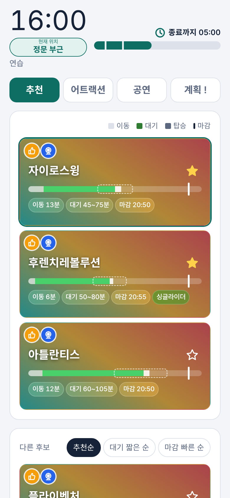
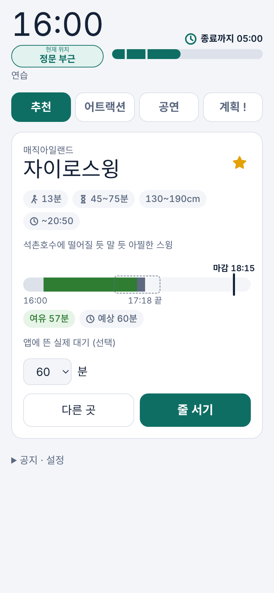
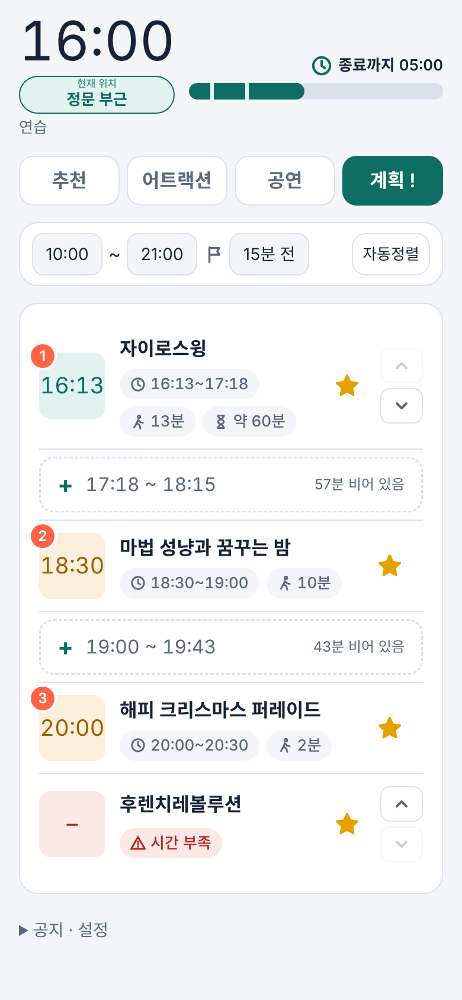
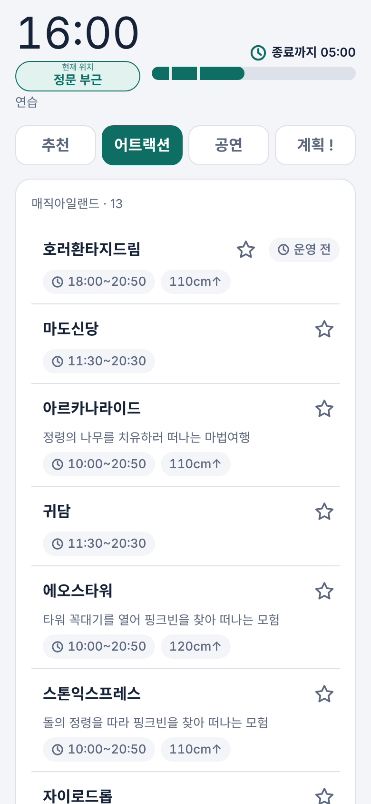
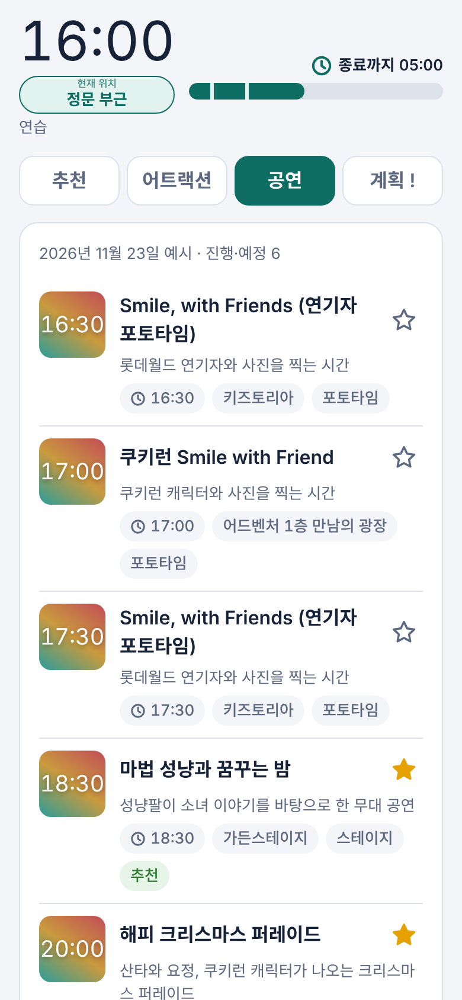
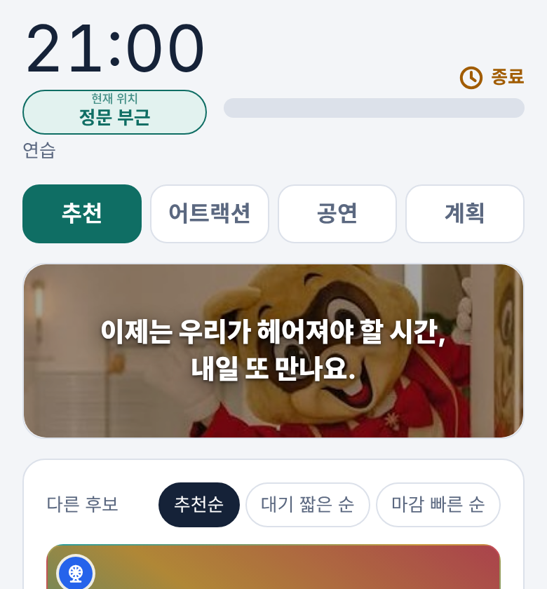

# 롯데월드 동선짜기

롯데월드 어드벤처에서 **지금 어디로 가면 좋을지** 바로 알려주는 모바일 웹앱입니다.
현재 시각과 내 위치, 이동시간, 예상 대기, 마감 시각, 꼭 보고 싶은 공연을 함께 따져서 다음 행선지를 추천하고, 하루 계획을 짜 줍니다.
날짜에 묶이지 않고, 공식 사이트의 그날 운영 정보를 불러와 누구나 언제든 쓸 수 있습니다.

**바로 쓰기:** https://blog.metaphr.dev/lotte/ (ksthink.github.io/lotte)

<p>



</p>

> 스크린샷은 연습 모드(16:00)에서 찍었습니다. 사진이 없는 카드는 그라데이션으로 표시되며, 실제 페이지에서는 공식 사진과 지도가 함께 나옵니다.

## 기능

### 추천
- 지금 갈 만한 어트랙션·공연을 카드로 보여줍니다. 카드마다 **이동 · 대기 · 마감** 시간과 시간 막대(이동 → 대기 → 탑승 → 마감선)가 있습니다.
- 꼭 할 것(★)과 다가오는 공연 시간을 지키면서 들를 수 있는 곳을 우선 추천합니다.
- '다른 후보'는 추천순 · 대기 짧은 순 · 마감 빠른 순으로 정렬해 10개까지 보여줍니다.
- 카드를 누르면 상세 화면이 열립니다. 앱에 뜬 **실제 대기시간**을 고르면 여유/초과를 다시 계산하고, 이후 예상 대기에도 반영합니다(보정).
- '줄 서기' → '탑승 완료'를 누르면 위치가 그 어트랙션으로 바뀌고, 다음 후보를 미리 보여줍니다.
- 상단의 '현재 위치'를 눌러 위치를 직접 바꿀 수 있습니다. 시계를 누르면 첫 화면으로 돌아갑니다.

### 어트랙션 · 공연
<p>


</p>

- **어트랙션 탭:** 구역별 전체 목록입니다. 이름 옆에 공식 **실시간 운행 상태**(정상운행, 운행종료, 점검 등)가 뜹니다. 카드를 펼치면 운영시간, 키 제한, 동반 탑승, 싱글라이더, '지금 가면' 예상이 나옵니다.
- **위치 지도:** 펼친 카드 아래와 선택 화면 아래에 공식 층별 지도와 위치 핀이 나옵니다. 지도를 누르면 크게 볼 수 있습니다.
- **공연 탭:** 오늘 공연 시간표입니다. 진행·예정 공연이 시간순으로 먼저 오고, 끝난 공연은 '종료' 묶음으로 뒤에 갑니다.
- 어트랙션과 공연 모두 ★로 '꼭 할 것'을 표시할 수 있습니다.

### 계획
- ★ 표시한 어트랙션과 공연으로 하루 순서를 짭니다. 공연은 시간에 고정되고, 퍼레이드는 미리 자리를 잡도록 일찍 도착하게 잡습니다.
- 시작·종료 시각과 퍼레이드 자리 잡기 시간(분)을 바꿀 수 있습니다. 빈 시간에는 그 사이에 할 수 있는 것을 제안합니다.
- 위아래 버튼으로 순서를 바꾸거나 '자동 정렬'로 이동이 짧은 순서를 찾습니다. 시간이 모자라면 '시간 부족'으로 표시합니다.

### 마감 · 기타


- 더 갈 곳이 없으면 마감 배너가 뜹니다.
- **연습 모드:** '공지 · 설정'에서 켜면 시각을 직접 정해 미리 동선을 연습할 수 있습니다. 연습 모드에서는 실시간 운행 상태로 거르지 않습니다.
- 기록과 ★, 설정은 이 기기의 브라우저(localStorage)에만 저장됩니다. 서버로 보내는 개인 정보는 없습니다.
- 다크 모드를 지원합니다.

## 계산 방식

- **이동시간:** 공식 가이드맵에 표시된 시설 위치로 만든 그래프에서 구한 걷는 시간(분)입니다.
- **예상 대기:** 2025년 평균 대기시간에 시간대별 계수와 보정값을 곱한 값입니다. 사용자가 실제 대기를 입력하면 보정값이 바뀝니다. 범위(최소~최대)로 보여줍니다.
- **마감:** 어트랙션은 공식 운영 종료 시각, 공연은 시작 시각 + 공식 진행 시간입니다.
- 모든 시각은 서울 시간(KST) 기준입니다.

이동시간과 예상 대기는 근사값입니다. 실제 대기와 운휴는 현장과 공식 앱이 기준입니다.

## 자료 출처

| 자료 | 출처 | 쓰는 방식 |
|---|---|---|
| 운행 상태 · 오늘 운영시간 | 롯데월드 어드벤처 공식 사이트 [어트랙션](https://adventure.lotteworld.com/enjoy/attrctn/list) | 페이지를 열 때와 3분마다 브라우저에서 불러옴 |
| 공연 시간표 · 진행 시간 · 소개 | 공식 사이트 [공연 › 타임테이블](https://adventure.lotteworld.com/enjoy/performance/list) | 그날(KST) 시간표를 불러옴 |
| 위치 지도 · 층 · 핀 좌표 | 공식 사이트 어트랙션 상세 페이지 | 카드를 처음 열 때 그 어트랙션만 불러옴 |
| 어트랙션 · 공연 사진 | 공식 사이트 이미지 | 공식 주소를 그대로 연결(저장소에 넣지 않음) |
| 어트랙션 기본 정보(이름, 구역, 키 제한, 싱글라이더 등) | 공식 사이트, 2026-11-18 조회 | `data/attractions.json`에 저장, 불러오기 실패 시 사용 |
| 시설 위치 좌표 | 롯데월드 어드벤처 2026 공식 가이드맵(PDF) | 좌표만 뽑아 이동 그래프로 변환 |
| 평균 대기시간 | [queue-times.com](https://queue-times.com) 2025년 평균 | 예상 대기의 기준값(30/60/90분 단위라 참고용) |
| 콩X고질라 대기 | 2026년 이용 후기 | 2025년 자료가 없어 기준값으로 사용 |
| 스페인해적선 운영 종료 | 2026-11-22 운행 종료(리뉴얼) 보도 | '운영 종료' 표시 |
| 마감 배너 사진(로티) | 롯데월드 | `assets/closed.jpg` |

공식 사이트를 불러오지 못하면(예: 다른 사이트 안에 넣어 미리보기할 때) 2026-11-18에 조회한 운영시간과 2026-11-23 공연 시간표를 **예시**로 보여줍니다.
공원 폐장 시각은 공식 사이트에서 따로 주지 않아, 계획 탭의 종료 시각(기본 21:00)을 직접 맞춰야 합니다.

이 프로젝트는 롯데월드와 관계없는 개인 프로젝트입니다. 롯데월드, 로티 및 공식 사이트의 사진·지도·문구의 권리는 롯데월드에 있습니다.

## 파일

- `index.html` — 앱 전체(HTML·CSS·JS 한 파일, 빌드 없음)
- `assets/closed.jpg` — 마감 배너 이미지
- `docs/screenshots/` — 이 문서의 스크린샷
- `data/attractions.json`, `data/attractions.csv` — 어트랙션 46종(공식 사이트 2026-11-18 기준 + 가이드맵 좌표·소개)
- `data/performances.json` — 2026-11-23 공연 시간표(불러오기 실패 시 예시)
- `data/lotteworld-graph.json`, `data/travel-minutes.csv` — 가이드맵 좌표로 만든 이동 그래프와 이동시간(분)
- `data/build_graph.py`, `data/build_attractions.py` — 생성 스크립트(가이드맵 PDF와 조회 결과가 있어야 다시 돌릴 수 있음)

## 로컬에서 보기

빌드 과정이 없습니다. `index.html`을 정적 서버로 열면 됩니다.

```sh
python3 -m http.server 8000
# http://localhost:8000
```
